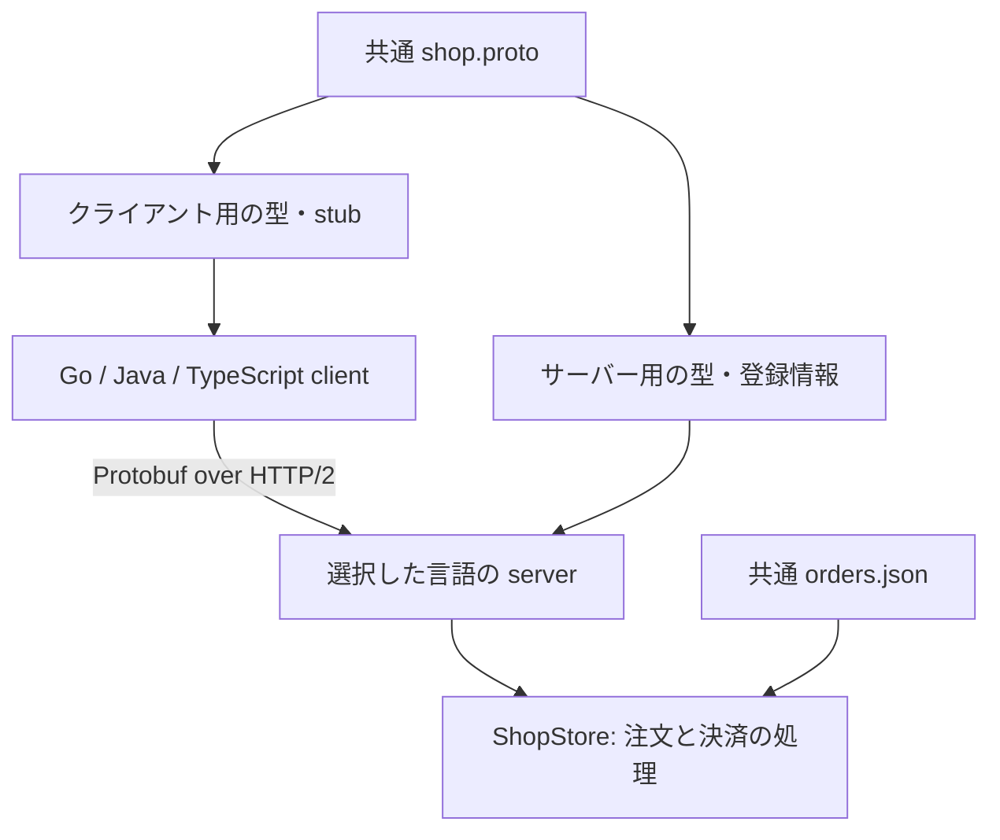

# gRPCをGo・Java・TypeScriptで学ぶ

同じ `.proto`、同じ注文データ、同じ期待値で、3言語の実装を比較する教材です。
「注文を取得して支払う」を題材に、サーバーとクライアントの両方を実装しています。
外部サービスのアカウント、APIキー、データベースは不要です。

## 採用するフレームワーク

| 言語 | フレームワーク／ライブラリ | 実装の入口 | 標準ポート |
| --- | --- | --- | --- |
| Go | 公式 gRPC-Go 1.83.2、Protobuf Go 1.36.12 | [server.go](go/internal/shop/server.go) | 50051 |
| Java | Spring Boot 4.1.1、公式 gRPC server/client starter | [ShopGrpcService.java](java/src/main/java/dev/hjosugi/grpc/ShopGrpcService.java) | 50052 |
| TypeScript | NestJS 12.0.1、gRPC-JS 1.14.4 | [shop.controller.ts](typescript/src/shop.controller.ts) | 50053 |

2026-09-06に公式ドキュメントとパッケージ公開元を確認。バージョンは再現性のため固定しています。
GoはgRPC-Go自体がRPCフレームワークです。JavaはSpringのDIと自動設定、TypeScriptはNestのModule・DI・decorator・Observableを使用します。
JavaはSpring Boot 4.1の `spring-boot-starter-grpc-server` / `spring-boot-starter-grpc-client` を使います。
古いサードパーティstarterの設定名と混ぜないでください。

## 最初に理解すること

`GetOrder("ord-1001")` は、普通の関数に似た形で呼び出せますが、実際は別プロセスへの通信です。
`.proto` がAPIの契約となり、生成されたコードとgRPC runtimeがProtobufの変換と通信を担当します。
RESTやJSONを経由することは必須ではありません。ブラウザーからの利用は別途gatewayやgRPC-Webを検討します。



3台は同じAPIの**代替実装**です。決済状態を3台間で同期する構成ではありません。
クライアントの接続先を変えることで、言語が違っても同じ契約で通信できることを学びます。

## 最短で動かす

Linux / macOS / WSLを想定した手順です。WindowsではWSLを推奨します。

必要なもの:

- Go 1.27.1（`go.mod` は1.27.0以上）
- JDK 17以上（検証は17、CIは21）
- Node.js 24以上、npm
- Python 3.10以上
- `protoc`（ローカル検証は35.1。proto3に対応する3.21以上でも本教材の構文は処理可能）
- Goのrace detector用Cコンパイラ

Mavenは同梱のMaven Wrapperが3.9.16を取得します。
インストール方法は[公式参照一覧](docs/references.md)を参照してください。

```bash
# Repository root
python3 scripts/dev.py setup
python3 scripts/dev.py build
python3 scripts/dev.py test
python3 scripts/dev.py interop
```

`setup` はGo用コード生成pluginとnpm依存を取得します。`build` は共通protoから各言語の型を生成し、3言語をビルドします。
`test` は各言語のテスト、`interop` は実際のTCP通信で3サーバーの契約テストと9通りの相互通信を実行します。
生成コードを手で編集する必要はありません。生成物はGit管理せず、元となるprotoを1箇所だけ管理します。

### 手でクライアントとサーバーを動かす

ターミナルAでGoサーバー:

```bash
python3 scripts/dev.py server go
```

ターミナルBで好きな言語のクライアント:

```bash
python3 scripts/dev.py client go --target localhost:50051
python3 scripts/dev.py client java --target localhost:50051
python3 scripts/dev.py client typescript --target localhost:50051
```

Javaサーバーなら `server java` とポート `50052`、TypeScriptサーバーなら `server typescript` と `50053` に変えます。
最後に `DEMO_OK` が出れば、そのクライアントによる4種類のRPCが完了しています。
同じサーバーでデモを繰り返しても、同じidempotency keyを使うため同じ決済が返ります。

代表的な期待値:

```json
{"paymentId":"pay-demo-pay-1001","orderId":"ord-1001","amountYen":"9800","status":"PAYMENT_STATUS_PAID"}
{"orderCount":2,"totalYen":"16800"}
```

表示名はGo/JavaのProtobuf JSONではcamelCase、TypeScriptのloader設定ではsnake_caseになります。
**通信上は同じfield numberと型を使います。**

## 共通APIとテストデータ

| RPC | 種類 | 入力例 | 結果 |
| --- | --- | --- | --- |
| `GetOrder` | Unary | `ord-1001` | Keyboard、9,800円 |
| `PayOrder` | Unary | 注文ID、支払方法、idempotency key | 決済IDと金額 |
| `ListOrders` | Server streaming | `customer-001` | 注文2件が順番に届く |
| `SummarizeOrders` | Client streaming | `ord-1001`、`ord-1002`を送って送信終了 | 2件、16,800円 |
| `TrackPayments` | Bidirectional streaming | 決済IDを送る | 送信終了を待たず、IDごとに1件返る |

`TrackPayments` は決済状態の**連続照会**です。状態変更のpush通知や永続的なsubscriptionではありません。

| 注文ID | 顧客 | 商品 | 数量 | 単価 | 合計 |
| --- | --- | --- | ---: | ---: | ---: |
| ord-1001 | customer-001 | Keyboard | 1 | 9,800円 | 9,800円 |
| ord-1002 | customer-001 | Mouse | 2 | 3,500円 | 7,000円 |
| ord-1003 | customer-002 | Monitor | 1 | 42,000円 | 42,000円 |

データの実体は [fixtures/orders.json](fixtures/orders.json) です。
金額は `int64` の円単位。JSONでは文字列にし、TypeScriptの集計は `BigInt` を使います。
`float` による金額計算やJavaScriptの整数精度低下を避けます。

## 学習の順番

1. [gRPCの基本と通信の流れ](docs/01-grpc-basics.md)
2. [Go: contextとstream](docs/02-go.md)
3. [Java: Spring BootのDIとstub](docs/03-java.md)
4. [TypeScript: NestJSとObservable](docs/04-typescript.md)
5. [エラー・再送・deadlineの演習](docs/05-exercises.md)
6. [英語のsystem design面接スクリプト](docs/06-interview.md)
7. [検証結果](docs/verification.md)

## エラーと再送の契約

| 条件 | gRPC status |
| --- | --- |
| 必須IDなし、不正な支払方法、不正なkey | `INVALID_ARGUMENT` (3) |
| 注文／決済がない | `NOT_FOUND` (5) |
| 同じkeyで異なる注文または支払方法 | `ALREADY_EXISTS` (6) |
| 支払済みの注文を別keyで支払う | `FAILED_PRECONDITION` (9) |
| `payment_method = declined` | `FAILED_PRECONDITION` (9)、決済を作らない |
| client/bidi streamに1,001件目を送る | `RESOURCE_EXHAUSTED` (8) |
| 明示的なクライアントdeadline超過 | `DEADLINE_EXCEEDED` (4) |
| クライアントがcancelする | `CANCELLED` (1) |

idempotency keyは `[A-Za-z0-9_-]{1,64}`。同じ成功済みリクエストの再送は同じ決済を返します。
失敗した決済はこの教材では記録しません。`declined` は固定のテスト用拒否です。
注文の新規作成は範囲外で、起動時の3件だけを使います。

## 設定

| 環境変数 | 用途 |
| --- | --- |
| `GRPC_TARGET` | 全クライアントの接続先 |
| `GRPC_ADDR` | Go / TypeScriptの待ち受け先 |
| `GRPC_HOST`, `GRPC_PORT` | Javaの待ち受け先 |
| `FIXTURES_PATH` | 注文データのパス。明示指定は絶対パスを推奨 |
| `PROTO_PATH` | TypeScriptのprotoパス |
| `DEMO_DELAY_MS` | `GetOrder` のみを0〜5,000ms遅らせる演習用設定 |

初期状態へ戻すにはサーバーを再起動します。
`interop` はテスト用サーバーを自動起動・終了し、ログを `.run/` に保存します。

## 実務に持ち込む前の変更点

この教材はlocalhostで動くメモリ内の模擬決済です。実際の課金は発生しません。
本番ではTLS/mTLSまたは認証、認可、永続DB、unique constraintとtransactionによるidempotency、決済事業者との整合性、期限付き再試行、metrics/tracingが必要です。
プロセス内のlockやNodeの同期処理だけでは、複数台の二重決済を防げません。
長いstreamでは、application-levelのbackpressureや再接続・再開も設計してください。

公開手順は [PUBLISH.md](PUBLISH.md)。ライセンスはMITです。
