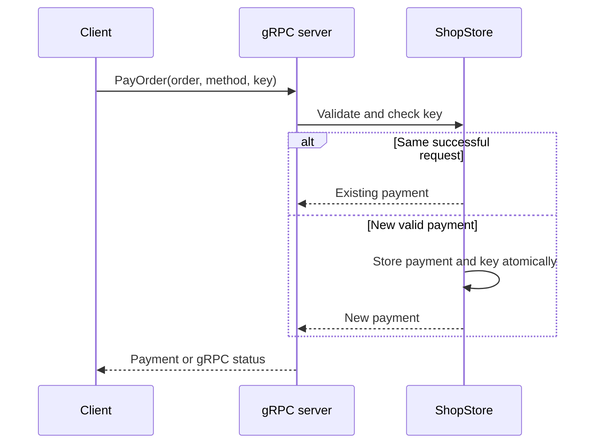

# gRPCの基本

## ローカル関数との違い

ローカル関数は同じプロセスのメモリ上で実行します。RPCはネットワーク越しに別プロセスで実行します。
呼び出し方が関数に似ていても、接続失敗、遅延、deadline、部分的な成功を考える必要があります。

本教材の `client` が注文管理側、`ShopService` が注文情報と模擬決済を提供する側です。
小さな教材として注文照会と決済を1サービスにまとめています。
実務でOrder ServiceとPayment Serviceを分離する場合にも、間のgRPC通信は同じ考え方です。



## `.proto`を読む

```protobuf
rpc GetOrder(GetOrderRequest) returns (Order);
message GetOrderRequest { string order_id = 1; }
```

`rpc` はリモートメソッド、左のmessageが入力、右が出力です。
`= 1` は初期値ではなくfield numberです。wire formatではこの番号が使われます。
Goの `OrderId`、Javaの `getOrderId()`、TypeScriptの `order_id` は同じフィールドを表します。

フィールドを追加するときは新しい番号を使います。削除した番号と名前は `reserved` にします。
既存番号の再利用や、wire互換性のない型変更は避けます。
`proto3` の通常のscalarは未設定の場合に既定値となるため、空文字列の検証をサーバー側で行います。

## stubとProtobuf

生成されたstubは、メソッド名・入力型・出力型・RPCの種類をruntimeに渡します。
Protobuf runtimeがmessageをバイナリに変換し、gRPCがメッセージ境界とstatus、HTTP/2上の通信を扱います。
JSONファイルをそのままネットワークへ送っているわけではありません。

画像によくある「ブラウザー → REST → サーバー → gRPC」という構成はgatewayを置いた例です。
本教材のCLIクライアントは直接gRPCを呼びます。
また、Protobufのバイナリを「JSONの各項目に固定長のtype/lengthを付けるだけ」と覚えないでください。
実際のencodingはfield numberとwire type、varint、length-delimitedなどの規則で決まります。

## 4種類を見分ける

| 書き方 | クライアント送信 | サーバー返信 | この教材 |
| --- | --- | --- | --- |
| `Request -> Reply` | 1件 | 1件 | 注文取得、決済 |
| `Request -> stream Reply` | 1件 | 複数件 | 注文一覧 |
| `stream Request -> Reply` | 複数件 | 最後に1件 | 注文金額の集計 |
| `stream Request -> stream Reply` | 複数件 | 複数件 | 決済の連続照会 |

client streamingの集計は、クライアントが送信を終了しないと最終結果を返せません。
bidiでは送信終了を待たずに返信できます。テストは「1件送る → 1件受け取る → 次を送る」を検証します。
順序は1つのstream内で保たれます。別のRPC呼び出し同士の完了順序は保証されません。

## deadlineとcancel

deadlineは待ち時間の上限です。すべてのクライアントに上限を設定しています。
タイムアウトしても「サーバーで何も実行されなかった」とは限りません。
決済成功後、返信だけが届かないことがあるため、同じkeyで照会・再送できる契約が必要です。
cancelは処理停止の通知です。外部の決済やDB transactionを自動で取り消す機能ではありません。

詳細は[gRPC deadlines](https://grpc.io/docs/guides/deadlines/)、[cancellation](https://grpc.io/docs/guides/cancellation/)、[Protobuf encoding](https://protobuf.dev/programming-guides/encoding/)を参照してください。
